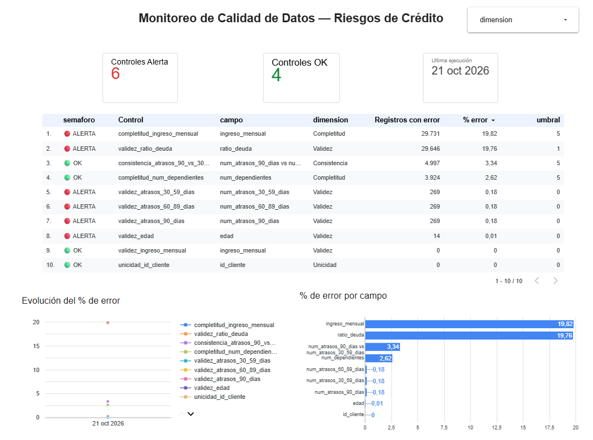
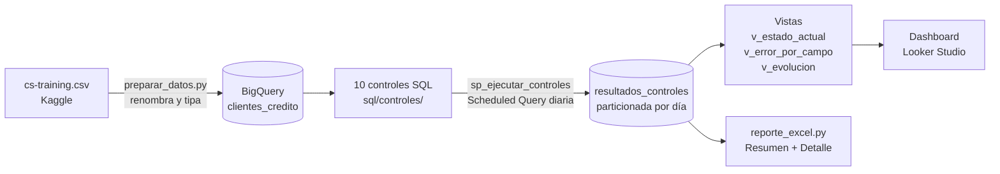

# Data Quality en BigQuery — Riesgos de crédito

Framework de **controles de calidad de datos** sobre una cartera de 150 000 clientes de crédito, construido en **Google BigQuery** con SQL estándar. Ejecuta 10 controles agrupados en 4 dimensiones de calidad, guarda el historial de resultados, se ejecuta solo cada día y alimenta un dashboard en Looker Studio y un reporte en Excel.

> Proyecto de portafolio orientado a un rol de **Data Quality en el área de Riesgos** de un banco.

**[▶ Ver el dashboard en vivo (Looker Studio)](https://lookerstudio.google.com/reporting/c6b71052-aed3-4c8b-bd41-908d37a6d73a)**

[](https://lookerstudio.google.com/reporting/c6b71052-aed3-4c8b-bd41-908d37a6d73a)

---

## Objetivo

En Riesgos, un dato malo no es un problema técnico: es una **decisión de crédito mal tomada**. Un ingreso faltante impide medir la capacidad de pago, un código de sistema leído como número convierte a un cliente en moroso serial y un cliente duplicado infla la exposición de la cartera.

Este proyecto:

1. **Mide** la calidad de los datos con reglas de negocio explícitas y umbrales de tolerancia.
2. **Registra** cada ejecución para ver la evolución en el tiempo.
3. **Alerta** cuando un control supera su umbral.
4. **Explica** la causa raíz de cada hallazgo y su impacto en el riesgo.

## Arquitectura



| Capa | Componente | Qué hace |
|---|---|---|
| Ingesta | `scripts/preparar_datos.py` + `bq load` | Valida columnas, renombra a español (snake_case) y carga con un esquema tipado y documentado |
| Controles | `sql/controles/*.sql` | Una regla por archivo; cada una marca por cliente si fue **evaluado** y si **falló** |
| Orquestación | `sp_ejecutar_controles` (procedimiento) | Une los 10 controles, calcula `% de error` vs `umbral` e inserta el resultado |
| Automatización | Scheduled Query | Ejecuta `CALL riesgos_dq.sp_ejecutar_controles()` todos los días a las 06:00 (Lima) |
| Consumo | Vistas + Looker Studio + Excel | Semáforo, % de error por campo, evolución y detalle de registros con error |

## Dataset

[Give Me Some Credit](https://www.kaggle.com/c/GiveMeSomeCredit) (Kaggle, 2011): 150 000 clientes con su historial de atrasos, endeudamiento e ingreso, y si cayeron en mora grave (90+ días) en los 2 años siguientes.

| Columna original | Columna en BigQuery | Tipo | Nota |
|---|---|---|---|
| *(índice)* | `id_cliente` | INT64 | Número de fila del archivo original |
| SeriousDlqin2yrs | `mora_grave_2_anios` | INT64 | 0/1. INT64 y no BOOL para poder validar valores fuera de 0/1 y usar `AVG()` como tasa de mora |
| RevolvingUtilizationOfUnsecuredLines | `ratio_uso_lineas_rotativas` | FLOAT64 | |
| age | `edad` | INT64 | |
| NumberOfTime30-59DaysPastDueNotWorse | `num_atrasos_30_59_dias` | INT64 | |
| DebtRatio | `ratio_deuda` | FLOAT64 | |
| MonthlyIncome | `ingreso_mensual` | NUMERIC | Dinero: decimal exacto, sin errores de redondeo |
| NumberOfOpenCreditLinesAndLoans | `num_creditos_abiertos` | INT64 | |
| NumberOfTimes90DaysLate | `num_atrasos_90_dias` | INT64 | |
| NumberRealEstateLoansOrLines | `num_creditos_hipotecarios` | INT64 | |
| NumberOfTime60-89DaysPastDueNotWorse | `num_atrasos_60_89_dias` | INT64 | |
| NumberOfDependents | `num_dependientes` | INT64 | |

Todas las columnas son `NULLABLE` a propósito: los datos se cargan **tal como vienen** y los errores se miden con los controles, en lugar de que la carga los rechace en silencio.

## Controles

| # | Control | Dimensión | Regla | Umbral | Fallidos | % error | Estado |
|---|---|---|---|---|---:|---:|---|
| 1 | `completitud_ingreso_mensual` | Completitud | `ingreso_mensual` no nulo | ≤ 5 % | 29 731 | 19,82 % | 🔴 ALERTA |
| 2 | `completitud_num_dependientes` | Completitud | `num_dependientes` no nulo | ≤ 5 % | 3 924 | 2,62 % | 🟢 OK |
| 3 | `unicidad_id_cliente` | Unicidad | `id_cliente` único y no nulo | 0 % | 0 | 0,00 % | 🟢 OK |
| 4 | `validez_edad` | Validez | 18 ≤ `edad` ≤ 100 | 0 % | 14 | 0,01 % | 🔴 ALERTA |
| 5 | `validez_ingreso_mensual` | Validez | `ingreso_mensual` ≥ 0 | 0 % | 0 | 0,00 % | 🟢 OK |
| 6 | `validez_ratio_deuda` | Validez | 0 ≤ `ratio_deuda` ≤ 5 | ≤ 1 % | 29 646 | 19,76 % | 🔴 ALERTA |
| 7 | `validez_atrasos_30_59_dias` | Validez | 0 ≤ atrasos ≤ 24 (máx. uno por mes en 2 años) | 0 % | 269 | 0,18 % | 🔴 ALERTA |
| 8 | `validez_atrasos_60_89_dias` | Validez | 0 ≤ atrasos ≤ 24 | 0 % | 269 | 0,18 % | 🔴 ALERTA |
| 9 | `validez_atrasos_90_dias` | Validez | 0 ≤ atrasos ≤ 24 | 0 % | 269 | 0,18 % | 🔴 ALERTA |
| 10 | `consistencia_atrasos_90_vs_30_59` | Consistencia | atrasos 90+ ≤ atrasos 30-59 | ≤ 5 % | 4 997 | 3,34 % | 🟢 OK |

**Resultado: 6 de 10 controles en ALERTA.** Cada archivo `.sql` explica en su encabezado la regla, el umbral y por qué importa para Riesgos.

- Los controles de **validez** solo evalúan registros no nulos: los nulos son responsabilidad de la **completitud**, para no contar un mismo problema dos veces.
- El control de **consistencia** es de *plausibilidad*. La columna 30-59 cuenta atrasos "que no empeoraron", así que un atraso que escaló a 90+ no suma en 30-59 y existen casos legítimos. Por eso tiene tolerancia.

## Hallazgos

Cifras reales obtenidas con los controles y con [`sql/analisis/causa_raiz.sql`](sql/analisis/causa_raiz.sql).

### 1. Uno de cada cinco clientes no tiene ingreso, y no es al azar
- **29 731 clientes (19,82 %)** sin `ingreso_mensual`, 4 veces la tolerancia del 5 %.
- Su tasa de mora es **5,61 %**, frente a **6,95 %** de quienes sí tienen ingreso. El nulo no es aleatorio: está relacionado con el perfil del cliente.
- **Impacto:** imputar estos nulos con el promedio sesga el modelo de score. Hay que tratarlos como un segmento propio o investigar el canal de origen.

### 2. `ratio_deuda` no es un ratio cuando falta el ingreso
- **29 646 registros (19,76 %)** con `ratio_deuda` fuera de rango (> 5).
- **El 98,9 %** de ellos tiene el ingreso nulo (27 294) o igual a 0-1 (2 031).
- Mediana de `ratio_deuda`: **0,30** cuando hay ingreso, frente a **1 135** cuando falta.
- **Causa raíz:** cuando no hay ingreso, el sistema origen guarda el **monto de la deuda** en vez del cociente. Es un error de cálculo en el origen, no de captura.
- **Impacto:** cualquier regla de sobreendeudamiento que use este campo rechaza o aprueba clientes con un número que no significa lo que dice.

### 3. Los códigos 96/98 esconden a los clientes más riesgosos
- **269 clientes** tienen 96 o 98 en las **tres** columnas de atraso a la vez. Es la firma de un código de sistema, no de un conteo; los máximos reales son 13, 11 y 17.
- Su tasa de mora es **54,65 %**, **8,2 veces** la general (6,68 %).
- **Impacto:** si se borran como "basura", el banco pierde justo a los clientes de mayor riesgo. Si se leen como números, el modelo ve 98 atrasos. **Lo correcto es separarlos como una categoría propia.**

### 4. Los dependientes faltan en los mismos clientes que el ingreso
- **3 924 clientes (2,62 %)** sin `num_dependientes`, dentro de la tolerancia.
- El **100 %** de ellos tampoco tiene ingreso. Hay una causa común en el origen (un canal o formulario que no captura datos socioeconómicos).

### 5. Edades imposibles
- **14 clientes** fuera de 18-100: 1 con edad **0** y 13 mayores de 100. Pocos, pero un menor de edad como titular es un riesgo legal.

### Lo que está bien
- **0** duplicados de `id_cliente` y **0** ingresos negativos.
- La consistencia entre atrasos (3,34 %) está dentro de la tolerancia.

### Candidatos a nuevos controles
- **1 634** clientes con ingreso exactamente **0**.
- **3 321** clientes (2,21 %) usan más del 100 % de su línea rotativa, y **241** más del 1 000 %.

## Estructura del repositorio

```
├── esquema/clientes_credito.json     # Esquema tipado y documentado de la tabla
├── scripts/
│   ├── preparar_datos.py             # Valida y renombra el CSV
│   ├── desplegar.py                  # Genera la consulta maestra y despliega en BigQuery
│   └── reporte_excel.py              # Ejecuta los controles y genera el Excel
├── sql/
│   ├── controles/                    # Un archivo por control (fuente única de verdad)
│   ├── 00_tabla_resultados.sql       # Tabla histórica particionada
│   ├── 01_consulta_maestra.sql       # Procedimiento generado a partir de los controles
│   ├── 02_vistas_dashboard.sql       # Vistas para Looker Studio
│   └── analisis/causa_raiz.sql       # Análisis de los hallazgos
└── requirements.txt
```

## Cómo ejecutarlo

### Requisitos
- Un proyecto de Google Cloud **con facturación activa** (la prueba gratuita sirve; el modo *sandbox* no permite `INSERT` ni Scheduled Queries).
- [Google Cloud CLI](https://cloud.google.com/sdk/docs/install) y Python 3.10+.

### 1. Autenticación y APIs
```bash
gcloud init
gcloud auth application-default login
gcloud services enable bigquery.googleapis.com bigquerydatatransfer.googleapis.com
```

### 2. Entorno de Python
```bash
python -m venv .venv
source .venv/bin/activate          # Windows: .venv\Scripts\activate
pip install -r requirements.txt
```

### 3. Datos
Descarga `cs-training.csv` desde [Kaggle](https://www.kaggle.com/datasets/brycecf/give-me-some-credit-dataset) a la carpeta `data/` y luego:
```bash
python scripts/preparar_datos.py
bq --location=US mk --dataset riesgos_dq
bq --location=US load --replace --source_format=CSV --skip_leading_rows=1 \
   riesgos_dq.clientes_credito data/clientes_credito.csv esquema/clientes_credito.json
```

### 4. Desplegar y ejecutar los controles
```bash
python scripts/desplegar.py        # tabla de resultados, procedimiento y vistas
python scripts/reporte_excel.py    # ejecuta los controles y genera reportes/reporte_dq_*.xlsx
```

Para agregar un control nuevo, crea un archivo en `sql/controles/` con las mismas columnas (`nombre_control, dimension, campo, umbral, id_cliente, valor, evaluado, fallido`) y vuelve a correr `desplegar.py`.

### 5. Programar la ejecución diaria (Scheduled Query)
```bash
bq --location=US mk --transfer_config \
   --data_source=scheduled_query \
   --display_name="DQ Riesgos - controles diarios" \
   --schedule="every day 11:00" \
   --params='{"query":"CALL riesgos_dq.sp_ejecutar_controles()"}'
```
- El horario está en **UTC**: 11:00 UTC son las 06:00 en Lima.
- La primera vez, `bq` muestra una URL para autorizar el servicio y pide pegar el `version_info` que aparece en la página.
- **En Windows**, PowerShell 5.1 y `bq.cmd` rompen las comillas y los paréntesis del JSON de `--params`. Ejecuta el comando desde **Cloud Shell** (bash) o crea la consulta desde la consola: **BigQuery → Scheduled queries → Create scheduled query**, con el texto `CALL riesgos_dq.sp_ejecutar_controles()` y la frecuencia diaria.

**Verificar que existe y que se ejecutó:**
```bash
bq ls --transfer_config --transfer_location=US
bq ls --transfer_run --run_attempt=LATEST projects/TU_PROJECT_NUMBER/locations/us/transferConfigs/TU_CONFIG_ID
```
O en la consola: **BigQuery → Scheduled queries**, con el historial de ejecuciones y sus errores. Para comprobarlo con datos:
```sql
SELECT DATE(fecha_ejecucion) AS dia, COUNT(*) AS controles, COUNTIF(estado = 'ALERTA') AS alertas
FROM `riesgos_dq.resultados_controles`
GROUP BY dia
ORDER BY dia DESC;
```

## Dashboard en Looker Studio (≈10 minutos)

1. Entra a [lookerstudio.google.com](https://lookerstudio.google.com) → **Crear → Informe**.
2. **Agregar datos → BigQuery → Mis proyectos →** `TU_PROJECT_ID` **→** `riesgos_dq` **→** `v_estado_actual` → **Agregar**.
3. **Semáforo por control**
   - Inserta una **Tabla**.
   - Dimensiones: `semaforo`, `nombre_control`, `dimension`, `campo`. Métricas: `registros_fallidos`, `pct_error`, `umbral`.
   - En el panel **Estilo → Formato condicional**: si `semaforo` **contiene** `ALERTA` → fondo rojo claro; si **contiene** `OK` → verde claro. Usa "contiene" y no "es igual a", porque el valor incluye el emoji (`🔴 ALERTA`).
4. **Indicadores (scorecards)**
   - Inserta un **Gráfico de resultados** con la métrica *Record Count* y un filtro `estado = ALERTA` → "Controles en alerta".
   - Duplica el gráfico con el filtro `estado = OK`.
5. **% de error por campo**
   - **Recurso → Administrar fuentes de datos → Agregar** `v_error_por_campo`.
   - Inserta un **Gráfico de barras**: dimensión `campo`, métrica `pct_error_max`, orden descendente.
6. **Evolución en el tiempo**
   - Agrega `v_evolucion` como fuente.
   - Inserta un **Gráfico de serie temporal**: dimensión `fecha`, desglose `nombre_control`, métrica `pct_error`.
   - Cambia la agregación de la métrica de **Suma** a **Promedio**: Looker suma las métricas por defecto, y sumar porcentajes no tiene sentido.
7. Agrega un **Control de filtro** por `dimension` y un **Gráfico de resultados** con `fecha_ejecucion` y agregación **Máx.** → "Última ejecución" (se actualiza solo; un texto fijo quedaría desactualizado).
8. **Compartir → Obtener enlace**. Las fuentes usan las credenciales del propietario, así que quien lo vea no necesita acceso a BigQuery.

> `pct_error` ya viene en escala 0-100: déjalo como **Número** con 2 decimales. El tipo *Porcentaje* de Looker espera valores entre 0 y 1.
>
> El dataset de Kaggle es estático, así que la evolución será plana hasta que cambien los datos. En producción, la tabla recibiría cargas nuevas cada día.

## Costos

| Operación | Costo |
|---|---|
| Carga con `bq load` y sentencias `CREATE` | Gratis |
| Almacenamiento (≈15 MB) | Dentro de los 10 GB gratuitos al mes |
| Una ejecución de los 10 controles | ≈10-20 MB leídos (el gratuito es 1 TB al mes, más de 50 000 ejecuciones) |

Medidas de control:
- Cada consulta de Python tiene un tope de **1 GB facturable** (`maximum_bytes_billed`). Si una consulta mal escrita intentara leer más, BigQuery la cancela antes de cobrar.
- La tabla de resultados está **particionada por día**, así que filtrar por fecha solo lee las particiones necesarias.

## Decisiones de diseño

- **Controles fila a fila.** Cada control devuelve `evaluado` y `fallido` por cliente. Con la misma lógica se calcula el resumen (para la tabla de resultados) y se extrae el detalle (para el Excel), sin duplicar reglas.
- **Una sola fuente de verdad.** La consulta maestra se **genera** a partir de `sql/controles/`, así que no se puede desincronizar de los controles.
- **Procedimiento + `CALL`.** La Scheduled Query solo ejecuta `CALL`. Cambiar o agregar controles no obliga a recrear la programación.
- **Un control que no evaluó nada es ALERTA.** Si una carga llega vacía, no se puede afirmar que los datos estén bien.
- **Sin ID de proyecto en el código.** Las consultas usan `riesgos_dq.tabla`, así que el repositorio funciona en cualquier proyecto.

## Próximos pasos
- Controles de **volumen** y **frescura** (¿llegó la carga de hoy? ¿con cuántas filas?).
- Controles para ingreso igual a 0 y uso de línea rotativa mayor al 100 %.
- Notificación por correo o Slack cuando un control pase a ALERTA.
- Ejecutar con una **cuenta de servicio** en lugar de credenciales personales.
